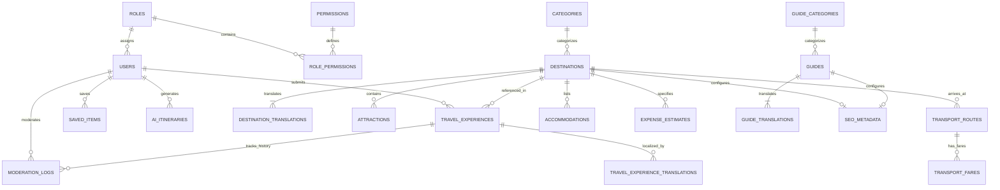
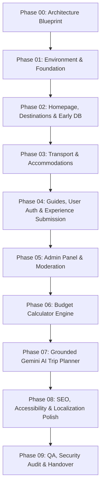

# Cholo-Ghuri — Project Architecture & Technical Blueprint (Phase 00)

**Document Version:** 2.1.0 (Final Phase 00 Revision)  
**Status:** Pending Review & Approval  
**Project Folder:** `Cholo Ghuri`  
**Framework Target:** Supported Laravel Release (Preferred: Laravel 13 with PHP 8.3+; Fallback: Laravel 12) with Blade, Bootstrap 5, MySQL  
**Scope Reference:** Strictly aligned with [MASTER_SCOPE.md](MASTER_SCOPE.md)

---

## 1. Architecture Overview & Technical Rationale

### 1.1 Project Philosophy
**Cholo-Ghuri** (`চলো-ঘুরি`) is a responsive, search-engine-optimized, bilingual tourism and travel advisory platform designed specifically for Bangladesh. It addresses the real-world fragmentation of local travel information: discovering destinations across all eight divisions, understanding realistic transport options and estimated costs, reading curated guides, sharing authentic traveler experiences, and generating practical, grounded itineraries assisted by AI.

### 1.2 Core Architectural Principles
1. **Monolithic Laravel Application (Server-Driven):**
   - Single unified Laravel application utilizing standard server-rendered Blade templates and Bootstrap 5 with custom CSS.
   - Avoids detached frontend frameworks (no React, Vue, or Next.js SPAs), ensuring minimal overhead, native search engine indexing, fast time-to-first-byte (TTFB), and simplicity in maintenance.
2. **Strict Bilingual Separation:**
   - **`/bn` (Bangla Mode):** User-facing content presented in authentic Bengali script (বাংলা লিপি).
   - **`/en` (Banglish Mode):** User-facing content presented in Banglish written using Latin script (e.g., *"Gontobbo ghure dekhen"*, *"Apnar budget onujayi plan korun"*), fulfilling the specific project requirement outlined in [MASTER_SCOPE.md](MASTER_SCOPE.md).
3. **Data Integrity & Price Disclaimers:**
   - Strict separation between **Reference / Estimated Prices** and **Confirmed / Live Prices**.
   - Every price card, fare estimate, and budget calculation displays its reference source and `last_verified_at` date.
   - All unverified figures, rates, operator names, and sample budgets are explicitly treated as illustrative placeholders until verified.
4. **Server-Grounded AI Integration:**
   - Google Gemini API is accessed strictly server-side via Laravel services.
   - No API keys or endpoint secrets are ever exposed in frontend assets, client JavaScript, or version control.
   - AI prompts are grounded strictly with platform database records to eliminate price and schedule hallucinations.
5. **Progressive Enhancement, Accessibility & Maps:**
   - Clean HTML5 semantics with WAI-ARIA roles, keyboard navigability, high color contrast (WCAG AA), responsive typography, and mobile-first Bootstrap 5 integration.
   - Destination coordinates (`latitude`, `longitude`) are structured to support lightweight, privacy-respecting maps (such as Leaflet.js with OpenStreetMap tiles) without requiring paid proprietary map services.
6. **Local Version Control Policy:**
   - Git is used exclusively for local development checkpoints.
   - **Strict Rule:** Never push to GitHub or upload the project to any external repository or hosting service without explicit user approval.

---

## 2. Environment Verification & Framework Compatibility Matrix

### 2.1 Installed Environment Inspection
- **Node.js:** `v22.19.0` (Verified — Installed & available)
- **Git:** `2.x` (Verified — Installed & available at `C:\Program Files\Git\cmd\git.exe`)
- **PHP:** **Not verified** (Not detected on system `PATH`; actual binary location/version unconfirmed)
- **Composer:** **Not verified** (Not detected on system `PATH`)
- **MySQL:** **Not verified** (Not detected on system `PATH`)

### 2.2 Framework Version Strategy & Security Support
Laravel 11 has reached its end of security support and is no longer recommended. The platform's version strategy strictly prioritizes active, security-supported releases:

| Target Laravel Version | Required PHP Runtime | Security Support Status | Strategic Recommendation |
| :--- | :--- | :--- | :--- |
| **Laravel 13** (Preferred) | **PHP 8.3+** | **Actively Supported** (Current Release) | **Primary Target:** Default choice once a compatible PHP 8.3+ environment is verified in Phase 01. |
| **Laravel 12** (Fallback) | **PHP 8.2+** | Security support ends **approx. February 2027** | **Conditional Fallback:** Used only if the user's local environment is constrained to PHP 8.2 and cannot run PHP 8.3+. |
| *Laravel 11 / 10* | *PHP 8.2 / 8.1* | **End of Life / Unsupported** | **Deprecated:** Not approved due to expired security support. |

> [!IMPORTANT]
> **Zero Premature Changes & Verification Rule:** In accordance with Phase 00 rules, no PHP runtime, Composer binary, or database server will be installed, upgraded, or initialized in this phase. During Phase 01, we will inspect your actual environment on disk, verify installed versions, and select the matching supported Laravel release (preferring Laravel 13 with PHP 8.3+) with your explicit approval.

---

## 3. Proposed Directory Structure

The project follows standard, idiomatic Laravel conventions without unnecessary abstraction layers:

```
Cholo Ghuri/
├── MASTER_SCOPE.md
├── PROJECT_BLUEPRINT.md
├── app/
│   ├── Http/
│   │   ├── Controllers/
│   │   │   ├── Admin/
│   │   │   │   ├── DashboardController.php
│   │   │   │   ├── DestinationController.php
│   │   │   │   ├── TransportController.php
│   │   │   │   ├── AccommodationController.php
│   │   │   │   ├── GuideController.php
│   │   │   │   ├── ExperienceModerationController.php
│   │   │   │   ├── UserController.php         # Admin User & Role Management
│   │   │   │   ├── AiConfigController.php     # Admin AI Configuration & Grounding
│   │   │   │   └── SeoController.php
│   │   │   ├── Auth/
│   │   │   │   ├── LoginController.php
│   │   │   │   └── RegisterController.php
│   │   │   ├── User/
│   │   │   │   ├── DashboardController.php
│   │   │   │   ├── ProfileController.php
│   │   │   │   ├── SavedItemController.php    # Bookmarked destinations & guides
│   │   │   │   └── ExperienceSubmissionController.php
│   │   │   ├── DestinationController.php
│   │   │   ├── GuideController.php
│   │   │   ├── ExperienceController.php
│   │   │   ├── TransportController.php
│   │   │   ├── BudgetCalculatorController.php
│   │   │   ├── AiPlannerController.php
│   │   │   └── PageController.php
│   │   ├── Middleware/
│   │   │   ├── SetLocale.php                  # Handles /en vs /bn prefix and app locale
│   │   │   ├── AdminAuthenticate.php          # Strict server-side admin role check
│   │   │   └── SecurityHeaders.php            # CSP, X-Frame-Options, XSS protection
│   │   └── Requests/                          # Form validation classes
│   │       ├── SubmitExperienceRequest.php
│   │       ├── BudgetCalculateRequest.php
│   │       ├── AiPlannerRequest.php
│   │       └── UpdateAiConfigRequest.php
│   ├── Models/
│   │   ├── User.php
│   │   ├── Role.php
│   │   ├── Permission.php
│   │   ├── Destination.php
│   │   ├── DestinationTranslation.php
│   │   ├── Category.php                       # Destination geographical categories
│   │   ├── Attraction.php
│   │   ├── TransportRoute.php
│   │   ├── TransportFare.php
│   │   ├── Accommodation.php                  # Lodging listings & properties
│   │   ├── ExpenseEstimate.php                # Baseline expense calculation models
│   │   ├── GuideCategory.php                  # Editorial topics (Budget, Solo, Trekking)
│   │   ├── Guide.php
│   │   ├── GuideTranslation.php
│   │   ├── TravelExperience.php
│   │   ├── TravelExperienceTranslation.php    # Localized experience fields
│   │   ├── ModerationLog.php                  # Audit trail of moderation decisions
│   │   ├── SavedItem.php                      # Polymorphic bookmarking
│   │   ├── AiItinerary.php
│   │   └── SeoMeta.php
│   └── Services/
│       ├── GeminiAiService.php                # Secure server-side Gemini API client
│       ├── BudgetCalculatorService.php        # Cost estimation math engine
│       ├── TranslationService.php             # Locale helpers & fallbacks
│       └── SeoManager.php                     # Dynamic meta, BCP 47 & Schema.org generator
├── config/
│   ├── gemini.php                             # Gemini API model parameters & limits
│   └── localization.php                       # Supported locales: ['en', 'bn']
├── database/
│   ├── migrations/                            # Database schema definition files
│   ├── seeders/                               # Seeders with realistic placeholder datasets
│   └── factories/
├── lang/
│   ├── bn/                                    # Bengali script translations
│   │   ├── common.php
│   │   ├── nav.php
│   │   ├── destinations.php
│   │   ├── calculator.php
│   │   └── ai_planner.php
│   └── en/                                    # Banglish (Latin script) translations
│       ├── common.php
│       ├── nav.php
│       ├── destinations.php
│       ├── calculator.php
│       └── ai_planner.php
├── public/
│   ├── css/
│   │   ├── bootstrap.min.css
│   │   └── custom.css                         # Brand styling & typography
│   ├── js/
│   │   ├── bootstrap.bundle.min.js
│   │   ├── calculator.js                      # Client-side calculator reactivity
│   │   └── main.js                            # Mobile nav, filters, UI helpers
│   └── images/
│       ├── logo/
│       ├── placeholders/
│       └── destinations/
├── resources/
│   ├── views/
│   │   ├── layouts/
│   │   │   ├── app.blade.php                  # Main public master layout
│   │   │   ├── user.blade.php                 # User dashboard layout
│   │   │   └── admin.blade.php                # Admin control panel layout
│   │   ├── components/                        # Reusable Blade component templates
│   │   │   ├── navbar.blade.php
│   │   │   ├── footer.blade.php
│   │   │   ├── destination-card.blade.php
│   │   │   ├── article-card.blade.php
│   │   │   ├── experience-card.blade.php
│   │   │   ├── transport-card.blade.php
│   │   │   ├── filter-bar.blade.php
│   │   │   ├── search-box.blade.php
│   │   │   ├── price-badge.blade.php          # Verified vs Estimate indicator
│   │   │   ├── alert.blade.php
│   │   │   └── pagination.blade.php
│   │   ├── pages/                             # Public bilingual page views
│   │   │   ├── home.blade.php
│   │   │   ├── destinations/
│   │   │   │   ├── index.blade.php
│   │   │   │   └── show.blade.php
│   │   │   ├── guides/
│   │   │   │   ├── index.blade.php
│   │   │   │   └── show.blade.php
│   │   │   ├── experiences/
│   │   │   │   ├── index.blade.php
│   │   │   │   ├── show.blade.php
│   │   │   │   └── create.blade.php
│   │   │   ├── transport/
│   │   │   │   └── index.blade.php
│   │   │   ├── calculator/
│   │   │   │   └── index.blade.php
│   │   │   ├── ai-planner/
│   │   │   │   └── index.blade.php
│   │   │   └── static/
│   │   │       ├── about.blade.php
│   │   │       ├── contact.blade.php
│   │   │       ├── privacy.blade.php
│   │   │       └── terms.blade.php
│   │   ├── user/                              # User profile & saved trips
│   │   └── admin/                             # Admin panel management views
└── routes/
    ├── web.php                                # Public bilingual routes (prefix: {locale})
    ├── user.php                               # Authenticated user routes
    ├── admin.php                              # Protected admin management routes
    └── console.php
```

---

## 4. Route & Bilingual URL Strategy

### 4.1 Locale Definition & Technical Standards
- **`/bn` Prefix:** Bengali Script (বাংলা লিপি).
  - HTML tag: `<html lang="bn-BD">`
- **`/en` Prefix:** Banglish written in Latin characters (Bengali phonetics in Latin alphabet).
  - HTML tag: `<html lang="bn-Latn">` (using official BCP 47 standard code for Bengali in Latin script).
  - Preserves `/en` in the URL pattern as required by [MASTER_SCOPE.md](MASTER_SCOPE.md) while informing search engines accurately of the script.
- **Root URL (`/`):** Detects browser preference or session cookie; safely redirects to default `/bn` (or `/en`).

### 4.2 Public Route Matrix
All public routes are scoped inside a Route Group with `prefix('{locale}')` and `where(['locale' => 'bn|en'])` processed by the `SetLocale` middleware.

| Route Name | Method | URI Pattern | Controller Action | Description |
| :--- | :--- | :--- | :--- | :--- |
| `home` | GET | `/{locale}` | `PageController@home` | Homepage with hero, featured spots, seasonal highlights |
| `destinations.index` | GET | `/{locale}/destinations` | `DestinationController@index` | Filterable destination catalog |
| `destinations.show` | GET | `/{locale}/destinations/{slug}` | `DestinationController@show` | Destination detail (attractions, transport, costs, map) |
| `guides.index` | GET | `/{locale}/guides` | `GuideController@index` | Travel articles & guides catalog |
| `guides.show` | GET | `/{locale}/guides/{slug}` | `GuideController@show` | Single guide article view |
| `experiences.index` | GET | `/{locale}/experiences` | `ExperienceController@index` | Community trip stories listing |
| `experiences.show` | GET | `/{locale}/experiences/{slug}` | `ExperienceController@show` | Community trip report breakdown |
| `experiences.create` | GET | `/{locale}/experiences/submit` | `ExperienceController@create` | Submission form (**Auth required**) |
| `experiences.store` | POST | `/{locale}/experiences/submit` | `ExperienceController@store` | Stores submission with `pending` status (**Auth required**) |
| `transport.index` | GET | `/{locale}/transport` | `TransportController@index` | Route & fare finder / comparison |
| `calculator.index` | GET | `/{locale}/budget-calculator` | `BudgetCalculatorController@index`| Interactive budget planner form |
| `calculator.estimate`| POST | `/{locale}/budget-calculator` | `BudgetCalculatorController@estimate`| Returns calculated estimate breakdown |
| `ai-planner.index` | GET | `/{locale}/ai-planner` | `AiPlannerController@index` | AI itinerary generator input interface |
| `ai-planner.generate`| POST | `/{locale}/ai-planner/generate`| `AiPlannerController@generate` | Dispatches server-side Gemini prompt & presents plan |
| `pages.about` | GET | `/{locale}/about` | `PageController@about` | Platform mission, sources & guidelines |
| `pages.contact` | GET | `/{locale}/contact` | `PageController@contact` | Feedback and query form |
| `pages.privacy` | GET | `/{locale}/privacy` | `PageController@privacy` | Privacy policy & travel data disclaimers |
| `pages.terms` | GET | `/{locale}/terms` | `PageController@terms` | Terms of service |

### 4.3 User & Authentication Routes
Protected by `auth` middleware:
- `/{locale}/user/dashboard` — User profile, saved trips, submitted experiences.
- `/{locale}/user/saved-items` — Saved destinations, guides & AI itineraries.
- `/{locale}/user/my-experiences` — Edit / track moderation status of user's own submissions.

### 4.4 Admin Route Matrix
Separated under `/admin` and strictly protected by `auth` + `admin` middleware (server-side authorization):

| Route Name | Method | URI Pattern | Controller Action | Description |
| :--- | :--- | :--- | :--- | :--- |
| `admin.dashboard` | GET | `/admin/dashboard` | `DashboardController@index` | Content counts, pending moderation metrics, stale fares |
| `admin.destinations` | RESOURCE | `/admin/destinations` | `DestinationController` | CRUD destinations, attractions, and translations |
| `admin.transport` | RESOURCE | `/admin/transport` | `TransportController` | Manage routes, transport modes, ticket fares, verified dates |
| `admin.accommodations`| RESOURCE | `/admin/accommodations` | `AccommodationController` | Manage lodging listings, tiers, and price ranges |
| `admin.guides` | RESOURCE | `/admin/guides` | `GuideController` | Manage travel guides & guide categories |
| `admin.experiences` | GET, POST | `/admin/experiences/moderation`| `ExperienceModerationController` | Review, approve, reject, or edit community submissions |
| `admin.users` | GET, POST | `/admin/users` | `UserController@index` | Manage users, view activity, toggle active status |
| `admin.roles` | GET, POST | `/admin/roles` | `UserController@roles` | Manage roles and administrative permissions |
| `admin.ai-config` | GET, POST | `/admin/ai-config` | `AiConfigController@index` | Configure Gemini model, temperature, grounding rules |
| `admin.seo` | GET, POST | `/admin/seo` | `SeoController@index` | Global meta tags, sitemap controls, canonical settings |

---

## 5. Reusable Blade Layouts & Components

### 5.1 Master Layout Architecture
1. **`layouts/app.blade.php` (Public):**
   - Sets HTML `lang="bn-BD"` (for `/bn`) or `lang="bn-Latn"` (for `/en`).
   - Dynamic `<head>` including SEO titles, description, canonical link, `hreflang` alternates, and OpenGraph.
   - Includes `<x-navbar />`, `@yield('content')`, and `<x-footer />`.
   - Toast container for flash notices (success, warning, info).
2. **`layouts/user.blade.php`:**
   - Adds side navigation for user settings, saved bookmarks, and submitted trips.
3. **`layouts/admin.blade.php`:**
   - Dedicated administration shell with sidebar, moderation alerts, and quick actions.

### 5.2 Core Component Specifications

| Component | Blade Tag | Parameters / Props | Responsibilities |
| :--- | :--- | :--- | :--- |
| **Navbar** | `<x-navbar />` | `$currentLocale`, `$activeRoute` | Responsive navigation, brand logo, search trigger, language switcher, auth status. |
| **Footer** | `<x-footer />` | None | Disclaimers, quick links, category sitemap, copyright, bilingual note. |
| **Destination Card** | `<x-destination-card />` | `$destination`, `$locale` | Thumbnail, localized title, district/division badge, budget indicator, rating, bookmark button. |
| **Article Card** | `<x-article-card />` | `$guide`, `$locale` | Featured image, category tag, title, excerpt, reading duration, publication date. |
| **Experience Card** | `<x-experience-card />` | `$experience`, `$locale` | Traveler name, trip route, total cost spent badge, visit month/year, excerpt. |
| **Transport Card** | `<x-transport-card />` | `$route`, `$fare` | Origin-destination arrow, mode icon (Bus, Train, Launch, Air), fare range, verification badge. |
| **Price Badge** | `<x-price-badge />` | `$isEstimate`, `$source`, `$verifiedDate` | Color-coded pill (`Estimated` vs `Verified`) with tooltip displaying verification date & source. |
| **Filter Bar** | `<x-filter-bar />` | `$divisions`, `$categories`, `$budgets` | Mobile off-canvas / desktop horizontal filter with clear & apply controls. |
| **Alert / Notice** | `<x-alert />` | `$type` (info, warning, danger), `$message` | Accessible alert container for price disclaimers and submission feedback. |
| **Pagination** | `<x-pagination />` | `$paginator` | Bootstrap-styled accessible pagination preserving search queries & locale prefix. |

---

## 6. Frontend Sample Data Contracts

> [!WARNING]
> **ILLUSTRATIVE PLACEHOLDER NOTICE:** All numbers, fares, hotel tiers, names, dates, and sources below (e.g., Sajek Valley 4,500 BDT, bus fare 800–1,400 BDT, hotel rates, traveler names) are purely fictional development placeholders used to define JSON/Blade data structures. They are **NOT** verified real-world facts or live travel tariffs. Live prices must always be confirmed directly with official operators.

### 6.1 Destination Object Contract
```json
{
  "_notice": "ILLUSTRATIVE PLACEHOLDER ONLY — NOT A VERIFIED FACT",
  "id": 101,
  "slug": "sajek-valley",
  "division": "Chattogram",
  "district": "Rangamati",
  "category_id": 3,
  "category_name": "Hill Tracts & Nature",
  "coordinates": { "lat": 23.3821, "lng": 92.2938 },
  "best_time_to_visit": "October to March (Winter & Post-Monsoon)",
  "translations": {
    "bn": {
      "name": "সাজেক ভ্যালি",
      "tagline": "মেঘের রাজ্য ও পাহাড়ের মিতালী",
      "overview": "সাজেক ভ্যালি বাংলাদেশের রাঙ্গামাটি জেলার বাঘাইছড়ি উপজেলার অন্তর্গত একটি জনপ্রিয় পাহাড়ি পর্যটন কেন্দ্র...",
      "practical_tips": "চান্দের গাড়ি বুকিংয়ের সময় আর্মি এস্কোর্টের সময়সূচি মাথায় রাখুন। রাতে ঠান্ডা পড়ার সম্ভাবনা থাকে।"
    },
    "en": {
      "name": "Sajek Valley",
      "tagline": "Megher rajjo ar paharer shundorjo",
      "overview": "Sajek Valley holo Rangamati zilar Baghaichhari upazilar ekta khub popular pahari tourist spot...",
      "practical_tips": "Chander gari book korar shomoy army escort er time check korun. Raate thanda lagte pare."
    }
  },
  "estimated_budget_range": {
    "low": 4500,
    "medium": 7500,
    "high": 12000,
    "currency": "BDT",
    "basis": "per_person_for_2_days",
    "is_estimate": true,
    "source_reference": "Sample Traveler Estimates 2026 (Placeholder)",
    "last_verified_at": "2026-09-15"
  },
  "hero_image": "/images/destinations/sajek-hero.jpg",
  "gallery": [
    "/images/destinations/sajek-1.jpg",
    "/images/destinations/sajek-2.jpg"
  ],
  "attractions": [
    { "id": 1, "name_bn": "কংলাক পাহাড়", "name_en": "Konglak Pahar", "elevation": "1800 ft" },
    { "id": 2, "name_bn": "রুইলুই পাড়া", "name_en": "Ruinglui Para", "type": "Tribal Village" }
  ]
}
```

### 6.2 Transport Route & Fare Contract
```json
{
  "_notice": "ILLUSTRATIVE PLACEHOLDER ONLY — NOT A VERIFIED TARIFF",
  "id": 305,
  "origin": "Dhaka (Sayedabad / Mohakhali)",
  "destination_id": 101,
  "destination_name": "Khagrachhari (En route to Sajek)",
  "transport_mode": "Bus",
  "operator_type": "Non-AC / AC Chair Coach",
  "distance_km": 275,
  "duration_hours": "7 to 8 hours",
  "fare_details": {
    "currency": "BDT",
    "min_fare": 800,
    "max_fare": 1400,
    "is_estimate": true,
    "pricing_source": "Illustrative Operator Schedule (Placeholder)",
    "last_verified_at": "2026-08-20",
    "disclaimer_bn": "ঈদের সময় বা বিশেষ ছুটির দিনে ভাড়ার তারতম্য হতে পারে। কাউন্টারে যোগাযোগ করে নিশ্চিত হন।",
    "disclaimer_en": "Eid ba public holiday te vara kom beshi hote pare. Counter e jogajog kore confirm korun."
  }
}
```

### 6.3 Accommodation Listing & Expense Tier Contract
```json
{
  "_notice": "ILLUSTRATIVE PLACEHOLDER ONLY — NOT A VERIFIED RATE",
  "destination_slug": "sajek-valley",
  "lodging_listings": [
    {
      "id": 401,
      "name": "Cloud View Eco Resort (Sample Name)",
      "tier": "mid_range",
      "nightly_rate_range_bdt": "2500 - 4500",
      "amenities": ["Attached Bath", "Solar Backup", "Balcony View"],
      "source_reference": "Sample Resort Directory (Placeholder)",
      "last_verified_at": "2026-09-10"
    }
  ],
  "aggregate_expense_estimates": [
    {
      "tier": "backpacker",
      "duration_days": 2,
      "estimated_transport_bdt": 1800,
      "estimated_lodging_bdt": 1500,
      "estimated_food_bdt": 1200,
      "estimated_sightseeing_bdt": 1000,
      "contingency_bdt": 500,
      "total_estimated_cost_bdt": 6000,
      "is_estimate": true,
      "source_reference": "Community Aggregate Model (Placeholder)",
      "last_verified_at": "2026-09-10"
    }
  ]
}
```

### 6.4 Travel Guide / Article Contract
```json
{
  "_notice": "ILLUSTRATIVE PLACEHOLDER ONLY",
  "id": 501,
  "slug": "sajek-travel-guide-first-timers",
  "guide_category": "Trip Planning",
  "reading_time_minutes": 6,
  "author": { "name": "Tanvir Hasan (Sample Author)", "badge": "Verified Explorer" },
  "published_at": "2026-09-01",
  "translations": {
    "bn": {
      "title": "প্রথমবার সাজেক ভ্রমণ: সম্পূর্ণ গাইড ও খরচ হিসাব",
      "summary": "খাগড়াছড়ি হয়ে সাজেক ভ্রমণের সঠিক পরিকল্পনা, এস্কোর্ট টাইম, রিসোর্ট বুকিং এবং সতর্কতা।",
      "content_html": "<p>সাজেক ভ্যালি এখন মেঘপ্রেমীদের প্রথম পছন্দ...</p>"
    },
    "en": {
      "title": "Prothombar Sajek Bhromon: Complete Guide O Khoroch",
      "summary": "Khagrachhari hoye Sajek jawar plan, escort time, resort booking ar tips ekshathe.",
      "content_html": "<p>Sajek Valley ekhon megh bhalobashader first choice...</p>"
    }
  }
}
```

### 6.5 User-Submitted Travel Experience Contract
```json
{
  "_notice": "ILLUSTRATIVE PLACEHOLDER ONLY — NOT A VERIFIED EXPENSE REPORT",
  "id": 601,
  "slug": "sreemangal-3-days-under-6000-bdt",
  "user_id": 42,
  "traveler": { "name": "Nusrat Jahan (Sample Traveler)", "city": "Dhaka" },
  "destination_id": 204,
  "destination_name": "Sreemangal, Moulvibazar",
  "submission_locale": "bn",
  "travel_date": "November 2025",
  "duration_days": 3,
  "total_group_size": 2,
  "total_spent_bdt": 11500,
  "cost_per_person_bdt": 5750,
  "moderation_status": "approved",
  "cost_breakdown": {
    "transport": 2200,
    "accommodation": 4000,
    "food": 3200,
    "local_sightseeing_cng": 1500,
    "misc": 600
  },
  "original_submission": {
    "title": "দুইজনে ৩ দিনে মাত্র ১১,৫০০ টাকায় শ্রীমঙ্গল ভ্রমণ",
    "story": "আমরা ঢাকা কমলাপুর থেকে উপবন এক্সপ্রেসে শ্রীমঙ্গল পৌঁছাই...",
    "personal_tips": "বাইক্কা বিল যাওয়ার জন্য সকাল ৭টায় বের হলে সুন্দর পাখি দেখা যায়।"
  },
  "translations": {
    "en": {
      "title": "2 Jon e 3 Dine Matro 11,500 Takay Sreemangal Bhromon",
      "story_summary": "Dhaka Kamalapur theke Upabon Express e Sreemangal 3 diner shundor bhromon...",
      "personal_tips": "Baikka Bill jawar jonno shokal 7tay ber hole pakhir dekha pawa jay."
    }
  }
}
```

### 6.6 AI Itinerary Proposal Contract
```json
{
  "_notice": "ILLUSTRATIVE PLACEHOLDER ONLY — GROUNDED IN PLATFORM MOCK DATA",
  "itinerary_id": "gen-890887",
  "target_destination": "Cox's Bazar",
  "days_count": 3,
  "travel_style": "Moderate / Family",
  "total_estimated_budget_bdt": 16500,
  "is_grounded_in_db": true,
  "grounded_sources": ["Destinations DB Record #12", "Illustrative Train Schedule 2026"],
  "days": [
    {
      "day_number": 1,
      "title_bn": "কক্সবাজার পৌঁছানো ও সমুদ্র সৈকত দর্শন",
      "title_en": "Cox's Bazar Pouchano O Sea Beach Ghura",
      "morning": "Morning arrival by train/bus, hotel check-in.",
      "afternoon": "Laboni Beach exploration and seafood lunch.",
      "evening": "Sunset at Sugandha Beach & night market visit.",
      "daily_cost_estimate_bdt": 4500
    }
  ],
  "disclaimer": "This itinerary is generated with AI assistance based on platform reference estimates. Local prices, ferry schedules, and resort tariffs must be confirmed prior to departure."
}
```

---

## 7. Logical Database Entities & Relationships

### 7.1 Entity-Relationship Overview (Mermaid)



### 7.2 Entity Breakdown & Column Schema

1. **`users`**
   - `id` (BIGINT, PK, Auto Increment)
   - `name` (VARCHAR 100)
   - `email` (VARCHAR 150, Unique)
   - `password` (VARCHAR 255)
   - `role_id` (INT, FK to `roles`)
   - `is_active` (BOOLEAN, default true)
   - `timestamps`

2. **`roles` & `permissions`**
   - Standard roles: `admin`, `moderator`, `user`.
   - `permissions`: Granular actions (`manage_destinations`, `moderate_experiences`, `manage_users`, `manage_ai_config`).
   - `role_permissions`: Pivot table mapping roles to permissions.

3. **`categories` (Destination Categories)**
   - `id` (INT, PK)
   - `slug` (VARCHAR 100, Unique)
   - `name_bn` (VARCHAR 100) — e.g., পাহাড় ও প্রকৃতি
   - `name_en` (VARCHAR 100) — e.g., Pahar O Prokriti
   - `icon_class` (VARCHAR 50)

4. **`destinations`**
   - `id` (BIGINT, PK)
   - `slug` (VARCHAR 120, Unique, Indexed)
   - `division` (ENUM: Dhaka, Chattogram, Sylhet, Khulna, Barishal, Rajshahi, Rangpur, Mymensingh)
   - `district` (VARCHAR 80)
   - `category_id` (INT, FK to `categories`)
   - `latitude` (DECIMAL 10,7, Nullable)
   - `longitude` (DECIMAL 10,7, Nullable)
   - `featured_image` (VARCHAR 255)
   - `is_featured` (BOOLEAN, default false)
   - `status` (ENUM: draft, published, archived)
   - `timestamps`

5. **`destination_translations`**
   - `id` (BIGINT, PK)
   - `destination_id` (BIGINT, FK)
   - `locale` (VARCHAR 10: `bn` or `en`)
   - `name` (VARCHAR 150)
   - `tagline` (VARCHAR 255)
   - `overview` (TEXT)
   - `best_time_to_visit` (VARCHAR 255)
   - `practical_tips` (TEXT)
   - Unique composite: `(destination_id, locale)`

6. **`attractions`**
   - `id` (BIGINT, PK)
   - `destination_id` (BIGINT, FK)
   - `name_bn` (VARCHAR 150)
   - `name_en` (VARCHAR 150)
   - `entry_fee_estimate` (DECIMAL 8,2, default 0.00)
   - `image_url` (VARCHAR 255, Nullable)

7. **`transport_routes`**
   - `id` (BIGINT, PK)
   - `origin_city` (VARCHAR 100)
   - `destination_id` (BIGINT, FK to `destinations`)
   - `transport_mode` (ENUM: bus, train, launch, air, cng_microbus)
   - `distance_km` (INT, Nullable)
   - `approx_duration_hours` (DECIMAL 4,1)

8. **`transport_fares`**
   - `id` (BIGINT, PK)
   - `transport_route_id` (BIGINT, FK to `transport_routes`)
   - `class_name` (VARCHAR 100 - e.g., Shovon Chair, AC, Non-AC)
   - `min_fare` (DECIMAL 8,2)
   - `max_fare` (DECIMAL 8,2)
   - `is_estimate` (BOOLEAN, default true)
   - `source_reference` (VARCHAR 255)
   - `last_verified_at` (DATE)

9. **`accommodations` (Distinct from aggregate expense estimates)**
   - `id` (BIGINT, PK)
   - `destination_id` (BIGINT, FK to `destinations`)
   - `name` (VARCHAR 150)
   - `tier` (ENUM: budget, mid_range, premium)
   - `price_range_min` (DECIMAL 8,2)
   - `price_range_max` (DECIMAL 8,2)
   - `amenities_json` (JSON, Nullable)
   - `contact_number` (VARCHAR 50, Nullable)
   - `source_reference` (VARCHAR 255)
   - `last_verified_at` (DATE)

10. **`expense_estimates` (Baseline destination budget models)**
    - `id` (BIGINT, PK)
    - `destination_id` (BIGINT, FK to `destinations`)
    - `tier` (ENUM: backpacker, standard, comfort)
    - `duration_days` (INT, default 2)
    - `estimated_transport_bdt` (DECIMAL 8,2)
    - `estimated_lodging_bdt` (DECIMAL 8,2)
    - `estimated_food_bdt` (DECIMAL 8,2)
    - `estimated_activities_bdt` (DECIMAL 8,2)
    - `contingency_pct` (INT, default 10)
    - `total_estimated_cost_bdt` (DECIMAL 10,2)
    - `source_reference` (VARCHAR 255)
    - `last_verified_at` (DATE)

11. **`guide_categories` (Distinct editorial categories)**
    - `id` (INT, PK)
    - `slug` (VARCHAR 100, Unique)
    - `name_bn` (VARCHAR 100) — e.g., বাজেট ট্রাভেল, সোলো ট্রিপ
    - `name_en` (VARCHAR 100) — e.g., Budget Travel, Solo Trip
    - `icon_class` (VARCHAR 50)

12. **`guides` & `guide_translations`**
    - `id` (BIGINT, PK)
    - `slug` (VARCHAR 150, Unique)
    - `guide_category_id` (INT, FK to `guide_categories`)
    - `hero_image` (VARCHAR 255)
    - `reading_time` (INT)
    - `status` (ENUM: draft, published)
    - `published_at` (TIMESTAMP)
    - `guide_translations`: `(id, guide_id, locale, title, summary, content_html)`

13. **`travel_experiences`**
    - `id` (BIGINT, PK)
    - `user_id` (BIGINT, FK to `users` — **Mandatory foreign key**)
    - `destination_id` (BIGINT, FK to `destinations`)
    - `submission_locale` (VARCHAR 10: `bn` or `en`)
    - `traveler_name` (VARCHAR 100)
    - `travel_date` (VARCHAR 50)
    - `duration_days` (INT)
    - `total_group_size` (INT, default 1)
    - `total_cost_bdt` (DECIMAL 10,2)
    - `cost_breakdown_json` (JSON)
    - `original_title` (VARCHAR 255)
    - `original_story` (LONGTEXT)
    - `original_tips` (TEXT, Nullable)
    - `moderation_status` (ENUM: pending, approved, rejected)
    - `timestamps`

14. **`travel_experience_translations` (Optional Editorial Translations)**
    - `id` (BIGINT, PK)
    - `travel_experience_id` (BIGINT, FK to `travel_experiences`)
    - `locale` (VARCHAR 10: `bn` or `en`)
    - `title` (VARCHAR 255)
    - `story_summary` (TEXT)
    - `personal_tips` (TEXT, Nullable)

15. **`moderation_logs` (Audit Trail)**
    - `id` (BIGINT, PK)
    - `travel_experience_id` (BIGINT, FK to `travel_experiences`)
    - `moderator_user_id` (BIGINT, FK to `users`)
    - `previous_status` (VARCHAR 30)
    - `new_status` (VARCHAR 30)
    - `action` (ENUM: approved, rejected, edited, flagged)
    - `notes` (TEXT, Nullable)
    - `created_at` (TIMESTAMP)

16. **`saved_items` (User Bookmarks)**
    - `id` (BIGINT, PK)
    - `user_id` (BIGINT, FK to `users`)
    - `saveable_type` (VARCHAR 100 — Destination, Guide, AiItinerary)
    - `saveable_id` (BIGINT)
    - `notes` (VARCHAR 255, Nullable)
    - `timestamps`
    - Unique composite: `(user_id, saveable_type, saveable_id)`

17. **`ai_itineraries`**
    - `id` (BIGINT, PK)
    - `user_id` (BIGINT, FK, Nullable for guest generators)
    - `destination_id` (BIGINT, FK)
    - `prompt_inputs_json` (JSON)
    - `generated_itinerary_json` (JSON)
    - `disclaimer_acknowledged` (BOOLEAN, default true)
    - `timestamps`

18. **`seo_metadata`**
    - Polymorphic (`seoable_type`, `seoable_id`)
    - `locale` (`bn` or `en`)
    - `meta_title` (VARCHAR 100)
    - `meta_description` (VARCHAR 255)
    - `canonical_url` (VARCHAR 255, Nullable)
    - `og_image` (VARCHAR 255, Nullable)

---

## 8. SEO, Security & Localization Strategy

### 8.1 Bilingual Localization & BCP 47 Metadata
- **Language Detection & Symmetrical Routing:**
  - Route pattern: `/{locale}/...`
  - Language switcher toggles between `/bn/destinations/sajek-valley` and `/en/destinations/sajek-valley`.
- **Accurate HTML Language Tags & Hreflang:**
  - For `/bn` pages:
    ```html
    <html lang="bn-BD">
    <link rel="canonical" href="https://cholo-ghuri.test/bn/destinations/sajek-valley" />
    <link rel="alternate" hreflang="bn" href="https://cholo-ghuri.test/bn/destinations/sajek-valley" />
    <link rel="alternate" hreflang="bn-Latn" href="https://cholo-ghuri.test/en/destinations/sajek-valley" />
    <link rel="alternate" hreflang="x-default" href="https://cholo-ghuri.test/bn/destinations/sajek-valley" />
    ```
  - For `/en` pages:
    ```html
    <html lang="bn-Latn">
    <link rel="canonical" href="https://cholo-ghuri.test/en/destinations/sajek-valley" />
    <link rel="alternate" hreflang="bn" href="https://cholo-ghuri.test/bn/destinations/sajek-valley" />
    <link rel="alternate" hreflang="bn-Latn" href="https://cholo-ghuri.test/en/destinations/sajek-valley" />
    <link rel="alternate" hreflang="x-default" href="https://cholo-ghuri.test/bn/destinations/sajek-valley" />
    ```
  - **Technical Rationale:** Using `bn-Latn` accurately declares to search engines that the language is Bengali transcribed in Latin script (Banglish), avoiding indexing confusion associated with labeling Banglish copy as standard English (`en`), while strictly honoring the project's `/en` URL requirement.

### 8.2 SEO & Structured Data
- **Structured Data (Schema.org / JSON-LD):**
  - **`TouristDestination`** on Destination detail pages (name, geo-coordinates, description, touristType).
  - **`Article`** on Travel Guide pages (headline, author, datePublished, image).
  - **`Trip` / `Itinerary`** on AI-generated itinerary results.
- **Dynamic XML Sitemap:**
  - Dynamic bilingual sitemap at `/sitemap.xml` listing both `/bn` and `/en` canonical URLs with accurate `lastmod` timestamps.

### 8.3 Security Architecture & Server-Side Authorization

> [!CAUTION]
> **Robots.txt Security Clarification:** `robots.txt` is purely an advisory crawl directive for well-behaved search engines; **it provides zero security, zero confidentiality, and zero access control**. Malicious bots and unauthorized users completely disregard `robots.txt`. Private pages (`/admin/*`, `/{locale}/user/*`, and AI endpoints) are secured exclusively through server-side HTTP middleware and policies returning `401 Unauthorized` or `403 Forbidden`. Internal admin paths will not be listed in `robots.txt` to avoid advertising attack surfaces.

- **Server-Side API Key Isolation:**
  - Google Gemini API key resides strictly in the server-side `.env` file (`GEMINI_API_KEY`).
  - Never referenced in Blade views, client JavaScript, data attributes, or Git commits.
- **CSRF, XSS & Content Sanitization:**
  - Blade `{{ }}` auto-escapes all output.
  - All form submissions are protected via `@csrf`.
  - User travel experiences are sanitized server-side (HTMLPurifier or strict text escaping) before database persistence.
- **Admin Authorization Boundary:**
  - All `/admin/*` routes require `auth` and `admin` middleware checking `Auth::user()->role->name === 'admin'`.
  - UI navigation hiding is accompanied by strict controller-level Gates and Policies.
- **Submission Access Control:**
  - `/{locale}/experiences/submit` requires authenticated user login (`auth` middleware). Anonymous guest submissions are disabled to prevent spam and preserve moderation accountability.

---

## 9. Phased Implementation Roadmap & Dependencies

The implementation plan is structured sequentially to verify the environment first, build core user journeys, integrate the database early, and deliver testable milestones:



| Phase | Title | Scope & Objectives | Data Source |
| :--- | :--- | :--- | :--- |
| **Phase 00** *(Current)* | **Architecture & Blueprint** | System design, directory structure, data contracts, acceptance checklist. | None (Specification only) |
| **Phase 01** | **Environment & Foundation** | Inspect/configure local PHP, Composer, and MySQL; initialize matching supported Laravel application; set up bilingual routing middleware, Bootstrap 5 theme, and base master layouts (`app`, `admin`, `user`). | Configuration & Layout Mocks |
| **Phase 02** | **Homepage, Destinations & Early DB** | Build public Homepage (`/{locale}`) with brand hero, seasonal spots, and categories; create core migrations (`destinations`, `categories`, `attractions`, `translations`); seed initial destinations; connect dynamic Destination Discovery catalog and detail pages. | **MySQL Database Integration** |
| **Phase 03** | **Transport & Accommodations** | Create migrations and seeders for transport routes, fare tables, lodging listings, and aggregate expense estimates; build public route finder and lodging directory. | MySQL Database |
| **Phase 04** | **Guides, User Auth & Experiences** | Implement travel guides catalog & detail pages; set up user authentication (Login/Register); build user dashboard and authenticated experience submission form with `pending` moderation state. | MySQL Database |
| **Phase 05** | **Admin Panel & Moderation** | Admin authentication guard; destination/transport CRUD; moderation log audit queue for approving/rejecting user experiences; users & roles management; AI config UI. | MySQL Database (Admin Guard) |
| **Phase 06** | **Budget Calculator Engine** | Interactive multi-step budget estimation engine combining real transport, lodging, food, and local travel data with per-person and group calculations. | MySQL Cost Tables + Reactive JS |
| **Phase 07** | **Grounded Gemini AI Trip Planner** | Secure server-side Gemini service; prompt grounding using database destination records; rate limiting; clear disclaimer tags and itinerary saving. | Gemini API + MySQL DB Grounding |
| **Phase 08** | **SEO, Accessibility & Localization** | Dynamic sitemap (`/sitemap.xml`), BCP 47 `hreflang` validation, Schema.org JSON-LD, WCAG AA accessibility audit, Leaflet map integration, and performance polish. | Full Platform Stack |
| **Phase 09** | **QA, Security Audit & Handover** | End-to-end integration testing, CSRF/XSS audit, rate limiting verification, mobile responsiveness, acceptance sign-off. | Production-Ready Stack |

---

## 10. Risks, Assumptions & Decisions Requiring Approval

### 10.1 Technical Risks & Mitigations
1. **Local Tooling (PHP/Composer on Windows):**
   - *Observation:* System PATH currently does not expose `php`, `composer`, or `mysql` globally.
   - *Mitigation:* In Phase 01, we will detect your specific local setup (e.g., XAMPP installation directory or standalone PHP path) and configure PATH before initializing Laravel.
2. **Travel Price Volatility:**
   - *Risk:* Bus, train, and hotel fares fluctuate frequently in Bangladesh (e.g., Eid holidays, fuel price hikes).
   - *Mitigation:* Explicit disclaimer badges (`"Reference Estimate - Verified on [Date]"`) on every single cost item. Zero guarantees of real-time ticketing.
3. **AI Hallucinations:**
   - *Risk:* Gemini inventing nonexistent bus operators or inaccurate costs.
   - *Mitigation:* Strict system prompts requiring Gemini to structure plans using *only* verified destination records injected from the platform database.
4. **Community Submission Spam:**
   - *Risk:* Low-quality or promotional travel experience submissions.
   - *Mitigation:* Mandatory authentication for submissions and a mandatory moderation queue (`pending`) before any story is published.
5. **Accidental Repository Push:**
   - *Risk:* Exposing project secrets or unfinished code to external platforms.
   - *Mitigation:* Git is configured for local checkpoints only. No remote push commands will ever be executed.

### 10.2 Key Decisions for User Approval
1. **Banglish / Latin-Script BCP 47 Tagging (`bn-Latn`):**
   - *Decision:* `/en` URL prefix is retained for user navigation while the HTML metadata uses `lang="bn-Latn"` and `hreflang="bn-Latn"` to accurately represent Banglish without confusing search engines.
2. **Mandatory Authentication for Experience Submissions:**
   - *Decision:* Travel experience submissions require an active registered user account (`auth` middleware) to prevent automated bot spam and allow travelers to manage their submissions.
3. **Early Database Integration (Phase 02):**
   - *Decision:* Database migrations and seeders for destinations will be created directly in Phase 02 alongside the Homepage and Destination Discovery pages, eliminating redundant static mock work.

---

## 11. Acceptance Checklist

Before approving this revised blueprint and proceeding to Phase 01, verify that all requirements have been met:

- [ ] **Bilingual Strategy Aligned:** `/bn` (Bengali script) and `/en` (Banglish in Latin script) clearly defined with URL pattern `/{locale}/...` and BCP 47 `bn-Latn` metadata.
- [ ] **Supported Laravel Version Matrix Defined:** Compatible with verified local PHP runtime without premature assumptions.
- [ ] **Directory Structure Standardized:** Standard Laravel directory structure without detached frontend frameworks.
- [ ] **Route Architecture Defined:** Public, user, and admin route tables detailed with method, URI, and controller.
- [ ] **Component Plan Outlined:** Reusable Blade components identified with props and roles.
- [ ] **Data Contracts Formulated:** All sample data explicitly labelled as illustrative placeholders.
- [ ] **Database Schema Mapped:** Logical entities, columns, and relationships defined with an ER diagram, including distinct `accommodations` vs `expense_estimates`, `guide_categories`, `moderation_logs`, `saved_items`, and `travel_experience_translations`.
- [ ] **Admin Areas Completed:** Users/roles management and AI configuration UI clearly specified.
- [ ] **Security Boundaries Set:** Server-side authorization enforced; `robots.txt` clarified as advisory only; Gemini API key kept strictly server-side.
- [ ] **Phased Plan Corrected:** Phase 01 establishes foundation; Phase 02 delivers Homepage and early database integration.
- [ ] **Document Links Relative:** All machine-specific `file:///` URLs replaced with relative project links.
- [ ] **No Early Code Executed:** Workspace preserved; no migrations, packages, or premature code created during Phase 00.
